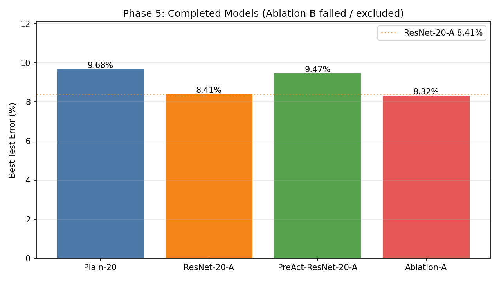

# Phase 5 最终汇总 — PreAct 消融分析

**约束：** 本文档仅做只读汇总，不新增训练、不重训 Ablation B、不修改任何已有实验原始结果。

**Ablation B：** `failed` / `numerical_instability`（已停止；未重训）。

## 指标总表

| 模型 | 状态 | Block 结构 | Best Test Error | Best Epoch | Train@Best | Final Train | Params |
|---|---|---|---:|---:|---:|---:|---:|
| Plain-20 | completed | `Conv -> BN -> ReLU -> Conv -> BN -> Add -> ReLU`（无 shortcut） | **9.68%** | 132 | 1.39% | 1.16% | 270,410 |
| ResNet-20-A | completed | `Conv -> BN -> ReLU -> Conv -> BN -> Add -> ReLU` | **8.41%** | 132 | 0.91% | 0.72% | 270,410 |
| PreAct-ResNet-20-A | completed | `BN -> ReLU -> Conv -> BN -> ReLU -> Conv -> Add` | **9.47%** | 128 | 1.81% | 1.45% | 270,314 |
| Ablation A | completed | `Conv -> BN -> ReLU -> Conv -> Add` | **8.32%** | 124 | 1.24% | 0.90% | 269,738 |
| Ablation B | failed | `BN -> ReLU -> Conv -> Conv -> Add` | NaN / failed | — | — | — | 269,642 |

### 相对差异（百分点）

- PreAct − ResNet-20-A：**+1.06 pp**（更差）
- Ablation A − ResNet-20-A：**−0.09 pp**（略好）
- Ablation A − PreAct：**−1.15 pp**（明显更好）
- Ablation B：无有效精度（NaN）

已完成模型排序（仅 completed）：Ablation A (8.32%) < ResNet-20-A (8.41%) < PreAct (9.47%) < Plain-20 (9.68%)

---

## 分析

### 1. PreAct 为什么没有改善 ResNet-20-A？

在本仓库**同一套 CIFAR-10 / 160 epoch / Option A / 单次运行**协议下，完整 PreAct（9.47%）比后激活 ResNet-20-A（8.41%）差 **1.06 pp**。可能原因（与证据绑定，非泛化断言）：

1. **深度区间不匹配。** He et al. (2016) 中 identity mapping / PreAct 的收益，主要与**很深**网络相关。CIFAR ResNet-20（每 stage n=3）偏浅；后激活基线本身已训练稳定（final train error 0.72%）。
2. **优化设定为后激活配方冻结。** 学习率、WD、Option A 是按 2015 后激活残差单元验证的。PreAct 改变了 BN/ReLU 相对 shortcut 的位置，同一套 SGD milestone 未必仍最优。
3. **拟合不足的直接观测。** 最佳测试 epoch 处，PreAct 训练误差 1.81%，高于 ResNet-20-A 的 0.91%，说明在相同预算下相对 underfit。
4. **结论边界。** 这只否证“在本协议下 drop-in PreAct 必优于 ResNet-20-A”，**不能**推出 PreAct 普遍更差。

### 2. Ablation A 为什么反而达到 8.32%？

Ablation A 仅去掉 PreAct 的**第一段 BN+ReLU**，得到 `Conv → BN → ReLU → Conv → Add`（相对经典 BasicBlock，仍**无 post-add ReLU**）。

- 经验上，它是本轮**已完成运行中最好**的结果（8.32%）：比 ResNet-20-A 好 0.09 pp，比完整 PreAct 好 **1.15 pp**。
- 机制假说（未严格证明）：去掉第一段 pre-activation，减轻了 PreAct 单元与本浅层 CIFAR 配方的错配；同时保留第二段 BN，以及 identity 式 Add（无最终 ReLU），在 lr=0.1 下更易训练。
- **谨慎：** 相对 ResNet-20-A 仅 0.09 pp，落在单次运行噪声范围内，**不能**宣称稳健超越 Phase 2 基线。
- 更清晰的一点：相对完整 PreAct，去掉第一段 BN+ReLU **显著帮助了**（+1.15 pp），说明第一段 PreAct 在本设置下**不是有益成分**。

### 3. Ablation B 为什么出现 NaN？

Ablation B 为 `BN → ReLU → Conv → Conv → Add`（去掉第二段 BN+ReLU）。

- 失败模式记录为 `numerical_instability`：训练 loss **从 epoch 0 起即为 NaN**，train/test error 卡在约 **90%**，约在 epoch **20** 停止（用户停止；未重训）。
- 与结构一致的原因：在冻结高初始学习率（0.1）下，**两层卷积之间没有 BN**，激活/梯度易爆炸。
- 因此 NaN 归因于 **消融后的 block 设计 + 冻结训练配方**，不是日志偶然错误。Ablation B **不能**作为有效精度结果参与排名。

### 4. 两个消融结果分别说明什么？

| 消融 | 改动 | 结果 | 解释 |
|---|---|---|---|
| A | 去掉第一段 BN+ReLU | 8.32%（有效） | 第一段 PreAct 在本设置下**非必要**；去掉后恢复到接近甚至略优于后激活水平（单次） |
| B | 去掉第二段 BN+ReLU | failed / NaN | 第二段 BN（第二层 Conv 前）对稳定性**关键**；去掉后按当前配方不可训 |

合读：在 Phase 2/3 控制变量下，**完整 PreAct 不是 ResNet-20 上的免费升级**；**第二段 BN+ReLU 对数值稳定性是负载关键的**，而**第一段 BN+ReLU 看起来可有可无，甚至可能有害**（浅层场景）。

### 5. 当前实验能支持什么结论，不能支持什么结论？

**能支持（带限定）：**

1. 相同协议下，残差后激活 ResNet-20-A 仍优于 Plain-20（8.41% vs 9.68%）——Phase 2 结论仍成立。
2. **完整 PreAct drop-in 未改善** ResNet-20-A（本 run −1.06 pp）。
3. **Ablation A**（无第一段 PreAct）在已完成运行中具有竞争力，且最好（8.32%）。
4. **Ablation B** 在去掉第二段 BN 后，按当前配方**不稳定**；不是有效精度结果。
5. PreAct 两段 BN+ReLU **重要性不等**：第一段可缺；第二段对可训性近乎必需。

**不能支持：**

1. PreAct 在 CIFAR/ImageNet 上普遍更差或更好（深度、配方、种子不同）。
2. Ablation A 已稳健超越 ResNet-20-A（Δ 仅 0.09 pp，单 seed）。
3. 把 Ablation B 的 ~90% error 当作公平精度比较。
4. 超出 block 顺序消融之外的因果断言（未测 SE/attention/aug 等）。
5. 多 seed 置信区间或统计显著性。

---

## 产物路径（只读引用）

- Plain-20: `experiments/runs/phase2/baseline/CifarResNet-20-P-N/09_03_2026/08_49_22`
- ResNet-20-A: `experiments/runs/phase2/baseline/CifarResNet-20-R-A/09_03_2026/09_53_41`
- PreAct-ResNet-20-A: `experiments/runs/phase3/preact_resnet20a/CifarPreActResNet-20-R-A/09_03_2026/16_23_57`
- Ablation A: `experiments/runs/phase5/ablation_a/CifarPreActAblationA-20-R-A/09_03_2026/18_59_29`
- Ablation B: `experiments/runs/phase5/ablation_b/CifarPreActAblationB-20-R-A/09_03_2026/20_08_23`

## 备注

- Phase 2/3/4/5 原始 metrics / checkpoints **未被本汇总步骤修改**。
- 未启动任何新训练，未重训 Ablation B。
